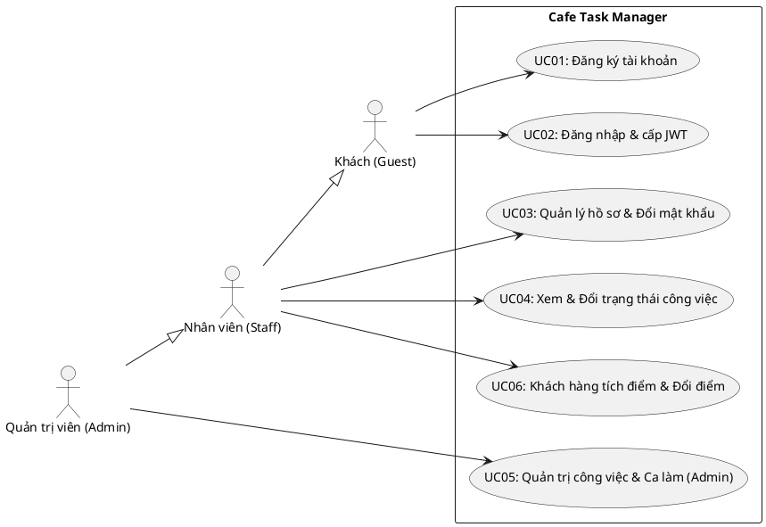

# Báo Cáo Cá Nhân – Thành Viên 2 (TV2)

- **Vai trò:** Xác thực, Phân quyền, Bảo mật & Khách hàng tích điểm
- **Môn học:** Phát triển ứng dụng Web (PROG2008)
- **Tài liệu liên quan:** `docs/bao-mat-ma-tran-quyen.md`, `docs/bao-mat-ra-soat.md`, `docs/tests/tv2.http`

---

## 1. Phân Tích Yêu Cầu & Mô Hình Use Case

### 1.1. Sơ đồ Use Case tổng quan

### 1.2. Đặc tả 5 Use Case chính

1. **UC01 – Đăng ký tài khoản (`POST /api/auth/register`):**
   - **Tác nhân:** Khách chưa đăng nhập.
   - **Luồng chính:** Nhập `fullName` (2–100 ký tự), `email` hợp lệ, `password` (>= 8 ký tự gồm chữ và số). Server kiểm tra trùng email (`409` nếu trùng), băm mật khẩu bằng `bcryptjs` (10 salt rounds), gán mặc định vai trò `Staff` và lưu vào `dbo.Users`.
2. **UC02 – Đăng nhập hệ thống (`POST /api/auth/login`):**
   - **Tác nhân:** Staff, Admin.
   - **Luồng chính:** Áp dụng `express-rate-limit` tối đa 20 lần / 15 phút / IP (`429` nếu vượt ngưỡng). Đối chiếu mật khẩu qua `bcrypt.compare`. Thành công cấp JWT (`{ id, email, role }`, hạn 8 giờ); sai trả `401` thông báo chung để tránh lộ tồn tại email.
3. **UC03 – Quản lý hồ sơ & Đổi mật khẩu (`GET/PUT /api/me`):**
   - **Tác nhân:** Staff, Admin đã đăng nhập (`verifyToken`).
   - **Luồng chính:** Xem `id`, `fullName`, `email`, `role`, `createdAt` (ẩn `PasswordHash`). Khi đổi mật khẩu phải nhập đúng `currentPassword` và `newPassword` đạt chuẩn mạnh trước khi băm lại vào CSDL.
4. **UC04 – Phục vụ danh sách nhân sự phân công (`GET /api/users`):**
   - **Tác nhân:** Staff, Admin đã đăng nhập.
   - **Luồng chính:** Trả danh sách nhân sự chỉ gồm `id`, `fullName`, `role` để phục vụ gán người thực hiện công việc mà không làm lộ email hay hash mật khẩu.
5. **UC05 – Khách hàng tích điểm (`[TV2-X8]`, `/api/customers`):**
   - **Tác nhân:** Staff (tìm kiếm, xem, thêm khách, cộng điểm, đổi điểm) và Admin (toàn quyền gồm cả sửa và xóa khách).
   - **Luồng chính:** Tìm kiếm theo tên/SĐT (escape `%`, `_`, `[`), tích điểm theo hóa đơn (`FLOOR(amount / 10000)`), đổi điểm bằng câu lệnh nguyên tử chống âm điểm và tính hạng động (`Đồng` / `Bạc` / `Vàng`).

---

## 2. Xác Thực, Phân Quyền & Bảo Mật Hệ Thống

### 2.1. Kiến trúc bảo mật đã cài đặt
- **Kiểm tra dữ liệu hai lớp:** Phía client dùng `validateField` (`public/assets/js/ui.js`) trong `auth.js` và `customers.js`; phía server kiểm tra lại toàn bộ qua `server/utils/validators.js` (`isString`, `isEmail`, `isStrongPassword`, `isPositiveInt`, `isISODate`, `isTimeHHmm`, `isPhone`, `isOneOf`, `sendBadRequest`).
- **Mật khẩu & Phiên làm việc:** Băm mật khẩu bằng `bcryptjs` (10 rounds), không bao giờ trả `PasswordHash` ở bất kỳ API nào. Xác thực qua JWT Bearer Token (`verifyToken`) và phân quyền theo vai trò (`requireRole('Admin')`).
- **Phòng chống tấn công phổ biến:**
  - Chống Brute-force đăng nhập bằng `express-rate-limit` (`loginLimiter` 20 req / 15 phút).
  - Chống SQL Injection bằng 100% truy vấn tham số hóa `@param` qua `server/db.js`, escape ký tự đặc biệt `LIKE` (`[`, `%`, `_`).
  - Chống XSS bằng hàm `escapeHtml()` trước khi chèn dữ liệu vào DOM.
- **Chi tiết ma trận phân quyền và báo cáo rà soát:** Xem đầy đủ tại [docs/bao-mat-ma-tran-quyen.md](file:///c:/Users/LucasTUF/Projects/QuanLyQuanCoffe/docs/bao-mat-ma-tran-quyen.md) và [docs/bao-mat-ra-soat.md](file:///c:/Users/LucasTUF/Projects/QuanLyQuanCoffe/docs/bao-mat-ra-soat.md).

---

## 3. Tính năng mở rộng: Khách hàng tích điểm (`[TV2-X8]`)

- **Mục đích nghiệp vụ:** Lưu thông tin hội viên quán cà phê (họ tên, số điện thoại duy nhất), tích lũy điểm thưởng theo hóa đơn mua hàng (`10.000đ = 1 điểm`), cho phép đổi điểm thưởng an toàn không âm điểm và tự động phân hạng `Đồng` (`< 100`), `Bạc` (`100–299`), `Vàng` (`>= 300`).
- **Đối tượng sử dụng:**
  - **Staff:** Xem danh sách/chi tiết khách hàng, tìm kiếm theo tên hoặc SĐT, thêm khách hàng mới, cộng điểm theo hóa đơn và đổi điểm cho khách.
  - **Admin:** Có toàn bộ quyền của Staff, đồng thời được quyền sửa thông tin (`PUT`) và xóa khách hàng (`DELETE`).
- **Luồng xử lý (Frontend → API → CSDL):**
  1. Người dùng truy cập `public/customers.html`, `customers.js` gọi `requireLogin()` để kiểm tra phiên đăng nhập và tải dữ liệu qua `apiFetch('/api/customers?search=&page=&pageSize=10')`.
  2. Router `server/routes/customers.js` kiểm tra token qua `verifyToken`, validate đầu vào qua `server/utils/validators.js` (trong đó có `isPhone(v)`), thực thi truy vấn SQL tham số hóa tới bảng `dbo.Customers` qua `server/db.js`, tính động trường `rank` bằng hàm `getRank(points)` và trả JSON chuẩn.
  3. Khi cộng điểm (`POST /api/customers/:id/earn`), server kiểm tra `amount` nguyên từ `10.000` đến `1.000.000.000`, tính `FLOOR(amount / 10000)` và cộng trực tiếp trong SQL.
  4. Khi đổi điểm (`POST /api/customers/:id/redeem`), server cập nhật nguyên tử bằng `UPDATE dbo.Customers SET Points = Points - @points WHERE Id = @id AND Points >= @points`; nếu `rowsAffected = 0` và khách tồn tại thì trả HTTP `400` `'Không đủ điểm'`, đảm bảo cột `Points` không bao giờ âm kể cả khi gửi nhiều yêu cầu đồng thời.
- **Bảng CSDL liên quan:** `dbo.Customers (Id, FullName, Phone, Points, CreatedAt)` trong `database/schema-mo-rong.sql` (có `UNIQUE (Phone)` và `CHECK (Points >= 0)`).
- **File cài đặt:**
  - `server/utils/validators.js`
  - `server/routes/customers.js`
  - `public/customers.html`
  - `public/assets/js/customers.js`
  - `docs/tests/tv2.http`
  - `docs/bao-mat-ma-tran-quyen.md`

---

## 4. Test mở rộng (`[TV2-X8]`)

| Mã | Chức năng | Các bước | Kết quả mong đợi | Kết quả thực tế | Đạt? |
|:---|:---|:---|:---|:---|:---:|
| **TC-X8-01** | Tạo khách hàng mới (Staff) | Đăng nhập Staff, mở `customers.html` hoặc gửi `POST /api/customers` với `fullName` 2–100 ký tự và `phone` 10 chữ số | Trả `201 Created`, `points = 0`, `rank = 'Đồng'`, hiển thị trên bảng | API trả `201 Created` (`points: 0`, `rank: 'Đồng'`); trên `customers.html` hiển thị ngay khách mới và giữ nguyên 5 khách mẫu | Đạt |
| **TC-X8-02** | Chặn trùng SĐT & SĐT sai định dạng | Gửi `POST /api/customers` trùng `phone` đã có; sau đó gửi `phone: "abc"` | Trùng SĐT trả `409 Conflict`; `phone: "abc"` bị chặn bởi client `validateField` và server trả `400 Bad Request` | API trùng SĐT trả `409`; `phone: "abc"` trả `400` ở server và hiển thị lỗi tiếng Việt ngay dưới `#customerPhone` trên modal | Đạt |
| **TC-X8-03** | Tìm kiếm & Phân trang | Nhập từ khóa tên hoặc một phần SĐT (hoặc chứa `%`, `_`) trên `customers.html` / `GET /api/customers?search=...` | Lọc đúng bản ghi theo `FullName` hoặc `Phone` sau debounce 300ms, phân trang `renderPagination` chính xác | Tìm `0901234561` lọc đúng 1 dòng (`Nguyễn Văn An`), tìm `%` trả 0 dòng không lỗi SQL; xóa tìm kiếm trả về đủ 5 dòng | Đạt |
| **TC-X8-04** | Cộng điểm & Lên hạng | Gửi `POST /api/customers/:id/earn` với `amount = 9000`; sau đó gửi `amount = 1250000` | `amount = 9000` trả `400`; `amount = 1250000` cộng `+125` điểm, trả `200 OK` và `rank` chuyển thành `'Bạc'` | `amount = 9000` trả `400`; `1250000` cộng `+125` điểm lên `Bạc`, `1750000` lên `300` điểm hạng `Vàng`; xem trước modal khớp số thực tế | Đạt |
| **TC-X8-05** | Đổi điểm hợp lệ & Chống âm điểm | Gửi `POST /api/customers/:id/redeem` với `points = 30`; tiếp tục gửi `points = 999999` | Lần 1 trừ còn `95` điểm (`rank = 'Đồng'`); lần 2 trả `400` `'Không đủ điểm'`, điểm trong CSDL không âm | Trừ đúng số điểm và hạ hạng tương ứng; vượt điểm trả `400` `'Không đủ điểm'`; test 2 request đổi 60 song song khi còn 95 chỉ 1 request thành công (`35` điểm còn lại) | Đạt |
| **TC-X8-06** | Phân quyền Staff và Admin | Staff truy cập `customers.html`, đồng thời gọi `PUT /api/customers/:id` và `DELETE /api/customers/:id`; sau đó Admin gọi lại | Staff không thấy nút Sửa/Xóa trên UI và gọi API bị trả `403 Forbidden`; Admin sửa và xóa thành công (`200 OK`) | Staff có 0 nút Sửa/Xóa trên UI và API `PUT`/`DELETE` trả `403`; Admin sửa và xóa thành công (`200 OK`), responsive `375px`/`768px`/`1200px` không tràn ngang | Đạt |

---

## 5. Ảnh chụp cần có

1. `customers_desktop_list.png` — Trang `customers.html` trên Desktop (`1200px`), hiển thị bảng khách hàng, huy hiệu hạng `Đồng`/`Bạc`/`Vàng` và phân trang.
2. `customers_mobile_375.png` — Trang `customers.html` trên Mobile (`375px`), bảng chuyển sang dạng thẻ `.table-cards`, không tràn ngang.
3. `customers_earn_preview.png` — Modal Cộng điểm đang nhập số tiền hóa đơn và hiển thị xem trước số điểm sẽ cộng + hạng mới.
4. `customers_redeem_error.png` — Modal Đổi điểm hiển thị thông báo lỗi khi nhập vượt quá số điểm hiện có (`Không đủ điểm`).
5. `customers_staff_role.png` — Giao diện `customers.html` khi đăng nhập bằng tài khoản `Staff` (ẩn hoàn toàn nút Sửa và Xóa).
6. `customers_rest_client_403_409.png` — Kết quả chạy `docs/tests/tv2.http` với các ca lỗi `400`, `403`, `409`.
