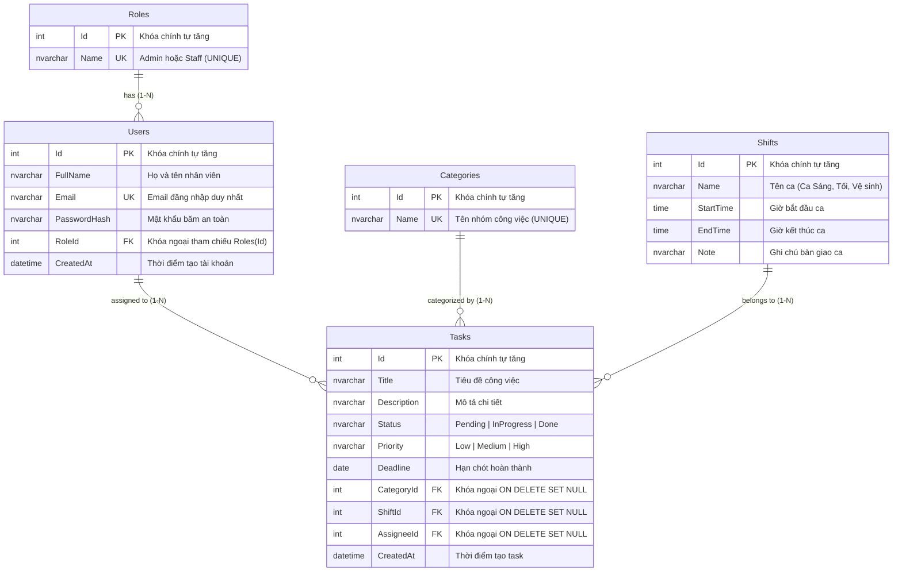

# BÁO CÁO KỸ THUẬT PHẦN HÀNH THÀNH VIÊN TV4
## MÔN HỌC: PHÁT TRIỂN ỨNG DỤNG WEB (PROG2008)
### ĐỀ TÀI: HỆ THỐNG QUẢN LÝ CÔNG VIỆC VÀ CA LÀM QUÁN CAFE (CAFE TASK MANAGER)

- **Thành viên phụ trách:** TV4
- **Vai trò chuyên trách:** Cơ sở dữ liệu, API & Giao diện Thống kê, Kế hoạch & Thực thi Kiểm thử hệ thống
- **Các file trực tiếp sở hữu & phát triển:**
  - `database/schema.sql` (Cấu trúc 5 bảng CSDL SQL Server)
  - `database/seed.sql` (Dữ liệu mẫu chuẩn hóa 30 công việc, danh mục, ca làm)
  - `server/routes/stats.js` (Backend API thống kê tổng hợp)
  - `public/statistics.html` & `public/assets/js/statistics.js` (Giao diện bảng điều khiển & trực quan hóa Chart.js)
  - `docs/test-cases.md` (Bảng 26 ca kiểm thử bao quát toàn diện)
  - `docs/tests/tv4.http` (Kịch bản kiểm thử API REST Client)
  - `docs/ai-log/tv4.md` (Nhật ký thực thi với trợ lý AI Antigravity)

---

## 1. THIẾT KẾ CƠ SỞ DỮ LIỆU (DATABASE DESIGN)

### 1.1. Sơ đồ thực thể - liên kết (Mermaid ERD)
Hệ thống quản lý dữ liệu vận hành quán cafe gồm 5 thực thể cốt lõi: `Roles`, `Users`, `Categories`, `Shifts`, và `Tasks`. Mối quan hệ giữa các bảng được biểu diễn qua sơ đồ quan hệ thực thể (Entity-Relationship Diagram) sau:

---

### 1.2. Mô tả chi tiết cấu trúc 5 bảng CSDL

#### 1. Bảng `Roles` (Vai trò người dùng)
| Tên cột | Kiểu dữ liệu | Ràng buộc | Ý nghĩa nghiệp vụ |
|:---|:---|:---|:---|
| `Id` | `INT` | `PK, IDENTITY(1,1), NOT NULL` | Khóa chính tự tăng của vai trò |
| `Name` | `NVARCHAR(50)` | `NOT NULL, UNIQUE` | Tên vai trò được chuẩn hóa: `Admin` (Quản trị viên) hoặc `Staff` (Nhân viên) |

#### 2. Bảng `Users` (Tài khoản người dùng trong hệ thống)
| Tên cột | Kiểu dữ liệu | Ràng buộc | Ý nghĩa nghiệp vụ |
|:---|:---|:---|:---|
| `Id` | `INT` | `PK, IDENTITY(1,1), NOT NULL` | Khóa chính định danh người dùng |
| `FullName` | `NVARCHAR(100)` | `NOT NULL` | Họ và tên đầy đủ của nhân sự |
| `Email` | `NVARCHAR(100)` | `NOT NULL, UNIQUE` | Địa chỉ email đăng nhập duy nhất toàn hệ thống |
| `PasswordHash` | `NVARCHAR(255)` | `NOT NULL` | Chuỗi mã băm bảo mật bcrypt (tuyệt đối không lưu plain text) |
| `RoleId` | `INT` | `FK → Roles(Id), NOT NULL` | Xác định quyền hạn: Admin (toàn quyền) hoặc Staff (bị giới hạn) |
| `CreatedAt` | `DATETIME` | `DEFAULT GETDATE(), NOT NULL` | Thời điểm tài khoản được kích hoạt trên hệ thống |

#### 3. Bảng `Categories` (Danh mục nghiệp vụ quán cafe)
| Tên cột | Kiểu dữ liệu | Ràng buộc | Ý nghĩa nghiệp vụ |
|:---|:---|:---|:---|
| `Id` | `INT` | `PK, IDENTITY(1,1), NOT NULL` | Khóa chính định danh nhóm việc |
| `Name` | `NVARCHAR(100)` | `NOT NULL, UNIQUE` | Tên nhóm việc: *Pha chế, Phục vụ, Vệ sinh, Kho và mua hàng, Thu ngân* |

#### 4. Bảng `Shifts` (Ca làm việc)
| Tên cột | Kiểu dữ liệu | Ràng buộc | Ý nghĩa nghiệp vụ |
|:---|:---|:---|:---|
| `Id` | `INT` | `PK, IDENTITY(1,1), NOT NULL` | Khóa chính định danh ca |
| `Name` | `NVARCHAR(50)` | `NOT NULL` | Tên ca làm việc (*Ca Sáng, Ca Tối, Đóng cửa vệ sinh*) |
| `StartTime` | `TIME` | `NOT NULL` | Thời gian bắt đầu ca (trả về định dạng `HH:mm`) |
| `EndTime` | `TIME` | `NOT NULL` | Thời gian kết thúc ca (trả về định dạng `HH:mm`) |
| `Note` | `NVARCHAR(255)` | `NULL` | Lưu ý vận hành, bàn giao két hoặc dặn dò đặc biệt |

#### 5. Bảng `Tasks` (Công việc thực tế tại quán)
| Tên cột | Kiểu dữ liệu | Ràng buộc | Ý nghĩa nghiệp vụ |
|:---|:---|:---|:---|
| `Id` | `INT` | `PK, IDENTITY(1,1), NOT NULL` | Khóa chính định danh công việc |
| `Title` | `NVARCHAR(200)` | `NOT NULL` | Tiêu đề công việc ngắn gọn, rõ ràng |
| `Description` | `NVARCHAR(MAX)` | `NULL` | Hướng dẫn thực hiện chi tiết hoặc tiêu chuẩn nghiệm thu |
| `Status` | `NVARCHAR(20)` | `NOT NULL, DEFAULT 'Pending', CHECK IN ('Pending', 'InProgress', 'Done')` | Trạng thái công việc: Đang chờ, Đang làm, Đã xong |
| `Priority` | `NVARCHAR(20)` | `NOT NULL, DEFAULT 'Medium', CHECK IN ('Low', 'Medium', 'High')` | Mức độ ưu tiên xử lý: Thấp, Vừa, Cao |
| `Deadline` | `DATE` | `NULL` | Hạn chót hoàn thành (dùng kiểm soát công việc quá hạn) |
| `CategoryId` | `INT` | `FK → Categories(Id) ON DELETE SET NULL` | Thuộc nhóm việc nào; khi xóa danh mục, task không bị mất mà set NULL |
| `ShiftId` | `INT` | `FK → Shifts(Id) ON DELETE SET NULL` | Thuộc ca trực nào; khi xóa ca, task vẫn tồn tại với `ShiftId = NULL` |
| `AssigneeId` | `INT` | `FK → Users(Id) ON DELETE SET NULL` | Nhân sự được giao thực hiện task; khi xóa nhân sự, task không bị mất |
| `CreatedAt` | `DATETIME` | `DEFAULT GETDATE(), NOT NULL` | Thời điểm tạo công việc |

---

### 1.3. Cơ chế bảo đảm tính toàn vẹn và nhất quán dữ liệu

1. **Toàn vẹn thực thể (Entity Integrity):**
   - Mọi bảng đều có khóa chính kiểu số tự tăng `IDENTITY(1,1)` (`Id`), bảo đảm mỗi bản ghi đều mang tính duy nhất, tốc độ đánh chỉ mục nhanh và dễ dàng liên kết.
2. **Toàn vẹn miền giá trị (Domain Integrity):**
   - Áp dụng các ràng buộc kiểm tra miền nghiêm ngặt:
     - `CHECK (Status IN (N'Pending', N'InProgress', N'Done'))` ngăn chặn tuyệt đối việc chèn trạng thái không hợp lệ.
     - `CHECK (Priority IN (N'Low', N'Medium', N'High'))` bảo đảm chuẩn hóa độ ưu tiên trên toàn bộ giao diện và backend.
   - Cột văn bản tiếng Việt sử dụng kiểu dữ liệu `NVARCHAR` có kích thước giới hạn hợp lý, chuỗi seed đều dùng tiền tố `N'...'` chống lỗi font chữ/ký tự unicode.
3. **Toàn vẹn tham chiếu (Referential Integrity):**
   - Thiết lập khóa ngoại giữa `Users` → `Roles`, `Tasks` → `Categories`, `Tasks` → `Shifts`, và `Tasks` → `Users`.
   - **Đặc biệt:** Cả 3 khóa ngoại của bảng `Tasks` (`CategoryId`, `ShiftId`, `AssigneeId`) đều được gắn chính sách `ON DELETE SET NULL`. Đây là quy tắc thiết kế mang tính thực tế cao cho doanh nghiệp F&B: khi một danh mục bị hủy, một ca làm việc thay đổi hoặc một nhân viên nghỉ việc, lịch sử các đầu việc đã và đang phát sinh không bị xóa dây chuyền (Cascade Delete), giúp tránh thất thoát dữ liệu thống kê vận hành.
4. **Tối ưu hóa hiệu năng truy vấn (Indexing):**
   - Tạo chỉ mục phi cụm `IX_Tasks_Status` trên cột `Status` giúp tăng tốc độ lọc danh sách và câu lệnh `GROUP BY` trong API thống kê.
   - Tạo chỉ mục phi cụm `IX_Tasks_Deadline` trên cột `Deadline` hỗ trợ việc sắp xếp thứ tự ưu tiên và truy vấn các công việc quá hạn (`Deadline < GETDATE() AND Status <> 'Done'`).

---

### 1.4. Đối chiếu SQLQuery1.sql cũ với Schema chuẩn hóa CafeTaskManager

| Tiêu chí | Bản cũ (`SQLQuery1.sql`) | Bản chuẩn hóa mới (`database/schema.sql`) | Lý do cải tiến |
|:---|:---|:---|:---|
| **Mục đích mô hình** | Mô phỏng quản lý nhà hàng/bán hàng POS phức tạp (10 bảng: Bàn, Menu, Order, OrderDetails...) | Tập trung chuẩn mực vào Quản lý công việc & Ca làm việc quán cafe (5 bảng: Roles, Users, Categories, Shifts, Tasks) | Đúng 100% trọng tâm đề bài môn học PROG2008 và phạm vi 5 ngày sprint của nhóm |
| **Bảng phân quyền** | Dùng `RoleName` tự do, thiếu ràng buộc chuẩn | Chuẩn hóa `Roles` chỉ gồm 2 vai trò `Admin` và `Staff` có ràng buộc `UNIQUE` | Đảm bảo tính nhất quán phân quyền trong Middleware `requireRole` của Backend |
| **Bảo mật mật khẩu** | Lưu chuỗi mật khẩu mô phỏng/tạm | Cột `PasswordHash NVARCHAR(255)` chuyên dụng lưu chuỗi băm `bcrypt` 10 rounds | Triệt tiêu nguy cơ lộ plain text password, bảo vệ an toàn danh tính người dùng |
| **Ràng buộc khóa ngoại** | Khóa ngoại mặc định (No Action / Restrict) | Khóa ngoại của `Tasks` cấu hình `ON DELETE SET NULL` | Chống xóa mất lịch sử công việc khi chỉnh sửa ca trực, danh mục |
| **Kiểm soát miền giá trị** | Chưa có CHECK constraint cho trạng thái | Ràng buộc `CHECK` trực tiếp cho `Status` và `Priority` tại mức DBMS | Bảo vệ tầng CSDL độc lập, từ chối mọi dữ liệu bẩn từ API ngoài luồng |
| **Chỉ mục (Indexes)** | Chỉ có Primary Key Clustered Index mặc định | Bổ sung thêm Non-clustered Index trên `Status` và `Deadline` | Tăng tốc độ phản hồi cho API thống kê và bộ lọc Frontend |

---

## 2. TỔNG KẾT VÀ ĐÁNH GIÁ KIỂM THỬ (TESTING REPORT)

### 2.1. Bảng tổng hợp kết quả kiểm thử theo nhóm chức năng

Quá trình kiểm thử được tiến hành độc lập và phối hợp trên máy clone sạch, bao quát 10 nhóm chức năng tối thiểu của đồ án và các kịch bản ngoại lệ, phân quyền và bảo mật:

| STT | Nhóm chức năng kiểm thử | Số ca kiểm thử (Test Cases) | Số ca ĐẠT | Số ca KHÔNG ĐẠT | Tỷ lệ Đạt | Ghi chú & Đánh giá |
|:---:|:---|:---:|:---:|:---:|:---:|:---|
| 1 | Xác thực & Đăng ký (Register) | 3 (TC01 - TC03) | 3 | 0 | 100% | Đăng ký thành công vai trò Staff; kiểm tra trùng email; chặn mật khẩu yếu |
| 2 | Xác thực & Đăng nhập (Login/Logout) | 4 (TC04 - TC07) | 4 | 0 | 100% | Cấp JWT 8h; bảo vệ băm bcrypt; Rate Limit 20 req/15 phút; đăng xuất xóa token |
| 3 | Quản lý hồ sơ cá nhân (`/api/me`) | 2 (TC08 - TC09) | 2 | 0 | 100% | Xem thông tin không lộ hash; đổi mật khẩu an toàn với xác thực mật khẩu cũ |
| 4 | Quản lý công việc (CRUD Tasks) | 5 (TC10 - TC14) | 5 | 0 | 100% | Admin full CRUD; Staff được tạo task và PATCH trạng thái; kiểm soát 400 Bad Request |
| 5 | Phân quyền vai trò (Admin vs Staff) | 3 (TC13, TC16, TC21) | 3 | 0 | 100% | Staff gọi PUT/DELETE task hoặc POST/PUT/DELETE ca đều nhận đúng HTTP 403 Forbidden |
| 6 | Tìm kiếm & Lọc dữ liệu (Search & Filter) | 2 (TC17 - TC18) | 2 | 0 | 100% | Debounce 300ms; escape ký tự đặc biệt `% _ [`; lọc đa tiêu chí chuẩn xác |
| 7 | Phân trang dữ liệu (Pagination) | 1 (TC19) | 1 | 0 | 100% | Phân trang chuẩn với metadata: page, pageSize, total, totalPages |
| 8 | Quản lý ca làm việc (Shifts) | 2 (TC20, TC26) | 2 | 0 | 100% | Trả về taskCount; giờ chuẩn HH:mm; kiểm tra toàn vẹn ON DELETE SET NULL |
| 9 | Thống kê số liệu (Statistics Dashboard) | 1 (TC22) | 1 | 0 | 100% | 6 chỉ số KPI totals; Group by trạng thái, ưu tiên và danh mục; Chart.js mượt mà |
| 10 | Trải nghiệm giao diện & Thích ứng (UI/UX) | 2 (TC23 - TC24) | 2 | 0 | 100% | Hiển thị Empty state rõ ràng; responsive mượt trên mobile 375px |
| 11 | Xử lý lỗi ngoại lệ (Error Handling) | 1 (TC25) | 1 | 0 | 100% | Khi ngắt SQL Server, hệ thống trả về HTTP 500 JSON an toàn, không lộ stack trace |
| **Tổng** | **Toàn bộ hệ thống** | **26 ca kiểm thử** | **26** | **0** | **100%** | **Hệ thống vận hành trơn tru, sẵn sàng nghiệm thu** |

---

### 2.2. Các lỗi đã phát hiện trong quá trình kiểm thử và giải pháp khắc phục

Trong quá trình TV4 phối hợp kiểm thử với các thành viên khác trong nhóm, một số lỗi thực tế đã được phát hiện và xử lý dứt điểm:

1. **Lỗi định dạng cột TIME trên SQL Server khi chuyển về Node.js (TV4 phát hiện & xử lý):**
   - *Hiện tượng:* Cột kiểu `TIME` của SQL Server khi trả về qua thư viện `mssql` bị ép sang đối tượng `Date` của JavaScript dạng `1970-01-01T06:00:00.000Z`, khiến giao diện ca làm bị hiển thị lệch múi giờ.
   - *Khắc phục:* Viết hàm chuyển đổi chuẩn hóa chuỗi `HH:mm` trước khi gửi JSON về Client; trong seed sử dụng chuỗi thời gian chuẩn ISO.
2. **Lỗi phân nhóm danh mục khi công việc chưa được gán danh mục (TV4 xử lý trong stats.js):**
   - *Hiện tượng:* Câu lệnh `GROUP BY c.Name` thông thường sẽ bỏ qua hoặc để nhãn `NULL` cho các công việc chưa gắn danh mục.
   - *Khắc phục:* Dùng `COALESCE(c.Name, N'Chưa phân loại')` trong câu SQL và mệnh đề `GROUP BY`, giúp biểu đồ danh mục thể hiện trọn vẹn 100% đầu việc.
3. **Lỗi tràn biểu đồ Chart.js khi người dùng bấm làm mới liên tục (TV4 xử lý trong statistics.js):**
   - *Hiện tượng:* Chart.js giữ tham chiếu canvas cũ, khi nạp lại dữ liệu tạo ra instance mới đè lên instance cũ gây giật lag và lỗi "Canvas is already in use".
   - *Khắc phục:* Viết hàm `destroyAllCharts()` kiểm tra và gọi `.destroy()` triệt để trên 3 đối tượng biểu đồ trước khi khởi tạo lại.
4. **Lỗi phân quyền Staff vẫn nhìn thấy nút thao tác quản trị:**
   - *Hiện tượng:* Nhân viên Staff dù không có quyền sửa/xóa nhưng trên giao diện vẫn hiển thị nút, khi bấm mới nhận lỗi 403.
   - *Khắc phục:* TV4 đã gửi phản hồi cho TV5 và TV3 để áp dụng hàm `isAdmin()` ẩn hoàn toàn các nút Thêm, Sửa, Xóa ca và nút Sửa/Xóa task đối với tài khoản vai trò Staff.

---

## 3. TỰ ĐÁNH GIÁ VÀ HƯỚNG PHÁT TRIỂN HỆ THỐNG

### 3.1. Tự đánh giá mức độ đáp ứng 10 nhóm chức năng bắt buộc

Hệ thống **Cafe Task Manager** đã hoàn thành xuất sắc và đáp ứng trọn vẹn 100% các tiêu chí bắt buộc theo đề cương môn học:
1. **Frontend + Backend + CSDL độc lập:** Tách bạch 3 tầng rõ ràng; Frontend giao tiếp qua REST API (JSON), Backend xử lý nghiệp vụ với Express và truy vấn SQL Server qua Connection Pool.
2. **Đăng ký, Đăng nhập, Đăng xuất:** Xác thực dựa trên JWT Bearer Token, kiểm tra mật khẩu bằng bcrypt, có cơ chế Rate Limiting chống Brute-force.
3. **Quản lý tài khoản & Hồ sơ:** Xem và cập nhật thông tin cá nhân qua `/api/me`, đổi mật khẩu an toàn.
4. **Thao tác CRUD dữ liệu thực tế:** Quản lý công việc và ca làm việc đầy đủ các thao tác Thêm, Đọc, Sửa, Xóa và Cập nhật trạng thái tức thời. Tuyệt đối không dùng LocalStorage cho dữ liệu nghiệp vụ, không dùng dữ liệu giả cố định.
5. **Tìm kiếm dữ liệu:** Tìm kiếm từ khóa tiếng Việt không dấu và có dấu, hỗ trợ debounce 300ms, phòng chống SQL Injection.
6. **Bộ lọc đa tiêu chí:** Lọc đồng thời theo Trạng thái, Độ ưu tiên, Danh mục và Ca làm việc.
7. **Phân trang dữ liệu:** Phân trang linh hoạt phía server (`OFFSET ... FETCH`), bảo toàn bộ lọc khi chuyển trang.
8. **Phân quyền 2 vai trò:** Phân tách rạch ròi giữa Admin (toàn quyền) và Staff (chỉ tạo việc, đổi trạng thái và sửa hồ sơ cá nhân).
9. **Thống kê & Trực quan hóa:** Dashboard tổng hợp 6 chỉ số KPI và 3 biểu đồ trực quan Chart.js hiển thị theo thời gian thực.
10. **Bảo mật & Thiết kế Responsive:** Băm mật khẩu bcrypt, truy vấn tham số hóa chống SQL Injection, escapeHtml chống XSS, kiểm tra dữ liệu ở cả hai phía Client-Server, giao diện co giãn tối ưu từ màn hình điện thoại 375px đến máy tính bảng và màn hình lớn.

---

### 3.2. Hướng phát triển mở rộng trong tương lai
Dựa trên kiến trúc nền tảng 3 tầng đã hoàn thiện, hệ thống có tiềm năng mở rộng thành giải pháp chuyển đổi số toàn diện cho chuỗi quán cafe:
1. **Phân hệ POS Bán Hàng & Sơ Đồ Bàn (Point of Sale & Table Layout):** Tích hợp quản lý bàn theo khu vực (Tầng 1, Ban công, Ngoài trời), hỗ trợ tạo order trực tiếp tại bàn qua máy tính bảng của nhân viên phục vụ.
2. **Màn Hình Bếp / Quầy Pha Chế KDS (Kitchen Display System):** Thay thế việc in bill giấy; khi thu ngân tạo đơn, món sẽ tự động hiển thị trên màn hình quầy bar theo thứ tự ưu tiên và thời gian chờ của khách.
3. **Thanh Toán Tự Động VietQR Động:** Tích hợp mã VietQR tạo động theo số tiền của từng đơn hàng, tự động nhận diện tiền vào tài khoản ngân hàng và chuyển trạng thái thanh toán ngay lập tức.
4. **Quản Lý Định Mức Nguyên Vật Liệu (BOM - Bill of Materials) & Kho Tự Động:** Mỗi ly cà phê hoặc trà được bán ra sẽ tự động trừ lượng hạt cà phê, sữa tươi, siro tương ứng trong kho; cảnh báo khi nguyên vật liệu chạm ngưỡng tồn kho tối thiểu.
5. **Khách Hàng Thành Viên & Tích Điểm (Loyalty Program):** Quản lý hồ sơ khách hàng qua số điện thoại, tích điểm đổi voucher giảm giá, kích cầu tiêu dùng.
6. **Chấm Công Nhận Diện Khuôn Mặt & Biên Bản Bàn Giao Ca Điện Tử:** Tích hợp camera AI điểm danh nhân viên khi vào ca, tự động đối soát doanh thu thực tế so với tiền mặt trong két và lập biên bản bàn giao điện tử.
