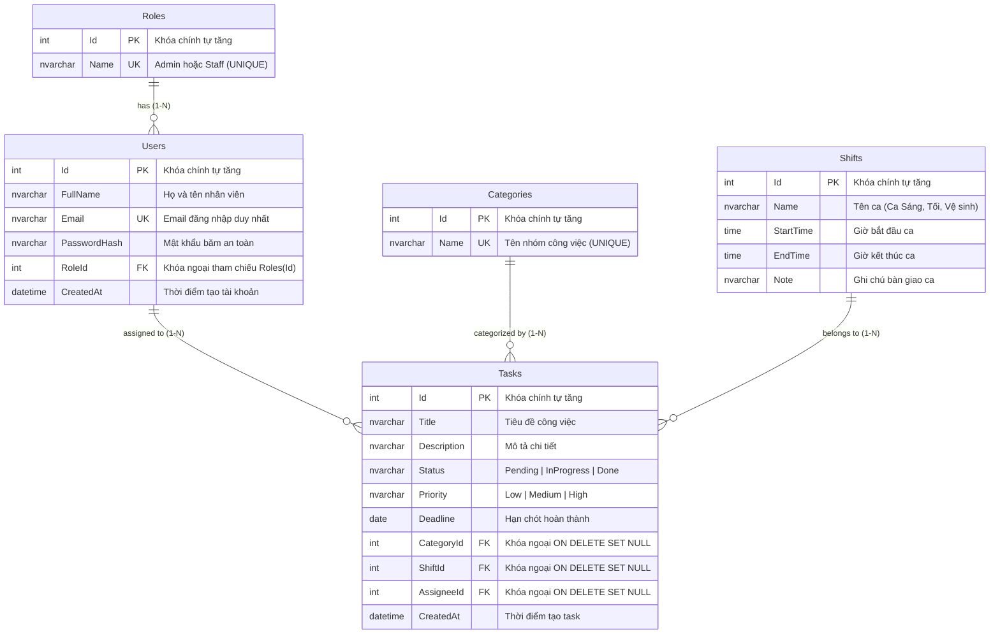

# BÁO CÁO KỸ THUẬT PHẦN HÀNH THÀNH VIÊN TV4
## MÔN HỌC: PHÁT TRIỂN ỨNG DỤNG WEB (PROG2008)
### ĐỀ TÀI: HỆ THỐNG QUẢN LÝ CÔNG VIỆC VÀ CA LÀM QUÁN CAFE (CAFE TASK MANAGER)

- **Thành viên phụ trách:** TV4
- **Vai trò chuyên trách:** Cơ sở dữ liệu, API & Giao diện Thống kê, Quản lý kho, Kế hoạch & Thực thi Kiểm thử hệ thống
- **Các file trực tiếp sở hữu & phát triển:**
  - `database/schema.sql` (Cấu trúc 5 bảng CSDL cốt lõi SQL Server)
  - `database/seed.sql` (Dữ liệu mẫu chuẩn hóa 30 công việc, danh mục, ca làm)
  - `database/schema-mo-rong.sql` (Cấu trúc 10 bảng CSDL mở rộng: Kho, Bàn, Menu, Order, Tích điểm, Lịch ca, Mẫu việc, Nhật ký)
  - `database/seed-mo-rong.sql` (Dữ liệu mẫu mở rộng tiếng Việt)
  - `server/routes/stats.js` (Backend API thống kê tổng hợp, theo nhân viên, theo ca, theo tuần và xuất CSV)
  - `server/routes/ingredients.js` (Backend API quản lý kho nguyên liệu và tự tạo việc nhập hàng)
  - `public/statistics.html` & `public/assets/js/statistics.js` (Giao diện bảng điều khiển & trực quan hóa Chart.js)
  - `public/inventory.html` & `public/assets/js/inventory.js` (Giao diện quản lý kho và cảnh báo hết hàng)
  - `docs/test-cases.md` (Bảng 48 ca kiểm thử bao quát toàn diện hệ thống cốt lõi và mở rộng)
  - `docs/tests/tv4.http` (Kịch bản kiểm thử API REST Client)
  - `docs/ai-log/tv4.md` (Nhật ký thực thi với trợ lý AI Antigravity)

---

## 1. THIẾT KẾ CƠ SỞ DỮ LIỆU CỐT LÕI (DATABASE DESIGN)

### 1.1. Sơ đồ thực thể - liên kết (Mermaid ERD)
Hệ thống quản lý dữ liệu vận hành quán cafe gồm 5 thực thể cốt lõi: `Roles`, `Users`, `Categories`, `Shifts`, và `Tasks`. Mối quan hệ giữa các bảng được biểu diễn qua sơ đồ sau:



---

### 1.2. Mô tả chi tiết cấu trúc 5 bảng CSDL cốt lõi

#### 1. Bảng `Roles` (Vai trò người dùng)
| Tên cột | Kiểu dữ liệu | Ràng buộc | Ý nghĩa nghiệp vụ |
|:---|:---|:---|:---|
| `Id` | `INT` | `PK, IDENTITY(1,1), NOT NULL` | Khóa chính tự tăng của vai trò |
| `Name` | `NVARCHAR(50)` | `NOT NULL, UNIQUE` | Tên vai trò: `Admin` (Quản trị viên) hoặc `Staff` (Nhân viên) |

#### 2. Bảng `Users` (Tài khoản người dùng hệ thống)
| Tên cột | Kiểu dữ liệu | Ràng buộc | Ý nghĩa nghiệp vụ |
|:---|:---|:---|:---|
| `Id` | `INT` | `PK, IDENTITY(1,1), NOT NULL` | Khóa chính định danh người dùng |
| `FullName` | `NVARCHAR(100)` | `NOT NULL` | Họ và tên đầy đủ của nhân sự |
| `Email` | `NVARCHAR(100)` | `NOT NULL, UNIQUE` | Địa chỉ email đăng nhập duy nhất toàn hệ thống |
| `PasswordHash` | `NVARCHAR(255)` | `NOT NULL` | Chuỗi mã băm bảo mật bcrypt (tuyệt đối không lưu plain text) |
| `RoleId` | `INT` | `FK → Roles(Id), NOT NULL` | Xác định quyền hạn: Admin (toàn quyền) hoặc Staff (bị giới hạn) |
| `CreatedAt` | `DATETIME` | `DEFAULT GETDATE(), NOT NULL` | Thời điểm tạo tài khoản trên hệ thống |

#### 3. Bảng `Categories` (Danh mục nghiệp vụ quán cafe)
| Tên cột | Kiểu dữ liệu | Ràng buộc | Ý nghĩa nghiệp vụ |
|:---|:---|:---|:---|
| `Id` | `INT` | `PK, IDENTITY(1,1), NOT NULL` | Khóa chính định danh nhóm việc |
| `Name` | `NVARCHAR(100)` | `NOT NULL, UNIQUE` | Tên nhóm việc: *Pha chế, Phục vụ, Vệ sinh, Kho và mua hàng, Thu ngân* |

#### 4. Bảng `Shifts` (Ca làm việc)
| Tên cột | Kiểu dữ liệu | Ràng buộc | Ý nghĩa nghiệp vụ |
|:---|:---|:---|:---|
| `Id` | `INT` | `PK, IDENTITY(1,1), NOT NULL` | Khóa chính định danh ca |
| `Name` | `NVARCHAR(50)` | `NOT NULL` | Tên ca làm việc (*Ca Sáng, Ca Tối, Đóng cửa vệ sinh*) |
| `StartTime` | `TIME` | `NOT NULL` | Thời gian bắt đầu ca (trả về định dạng `HH:mm`) |
| `EndTime` | `TIME` | `NOT NULL` | Thời gian kết thúc ca (trả về định dạng `HH:mm`) |
| `Note` | `NVARCHAR(255)` | `NULL` | Lưu ý vận hành, bàn giao két hoặc dặn dò đặc biệt |

#### 5. Bảng `Tasks` (Công việc thực tế tại quán)
| Tên cột | Kiểu dữ liệu | Ràng buộc | Ý nghĩa nghiệp vụ |
|:---|:---|:---|:---|
| `Id` | `INT` | `PK, IDENTITY(1,1), NOT NULL` | Khóa chính định danh công việc |
| `Title` | `NVARCHAR(200)` | `NOT NULL` | Tiêu đề công việc ngắn gọn, rõ ràng |
| `Description` | `NVARCHAR(MAX)` | `NULL` | Hướng dẫn thực hiện chi tiết hoặc tiêu chuẩn nghiệm thu |
| `Status` | `NVARCHAR(20)` | `NOT NULL, DEFAULT 'Pending', CHECK IN ('Pending', 'InProgress', 'Done')` | Trạng thái công việc: Đang chờ, Đang làm, Đã xong |
| `Priority` | `NVARCHAR(20)` | `NOT NULL, DEFAULT 'Medium', CHECK IN ('Low', 'Medium', 'High')` | Mức độ ưu tiên xử lý: Thấp, Vừa, Cao |
| `Deadline` | `DATE` | `NULL` | Hạn chót hoàn thành (dùng kiểm soát công việc quá hạn) |
| `CategoryId` | `INT` | `FK → Categories(Id) ON DELETE SET NULL` | Thuộc nhóm việc nào; khi xóa danh mục, task không bị mất mà set NULL |
| `ShiftId` | `INT` | `FK → Shifts(Id) ON DELETE SET NULL` | Thuộc ca trực nào; khi xóa ca, task vẫn tồn tại với `ShiftId = NULL` |
| `AssigneeId` | `INT` | `FK → Users(Id) ON DELETE SET NULL` | Nhân sự được giao thực hiện task; khi xóa nhân sự, task không bị mất |
| `CreatedAt` | `DATETIME` | `DEFAULT GETDATE(), NOT NULL` | Thời điểm tạo công việc |

---

## 2. CÁC TÍNH NĂNG MỞ RỘNG (TV4-E0, TV4-X6, TV4-X7)

### 2.1. Tác vụ TV4-E0: Cơ sở dữ liệu mở rộng 10 bảng
- **Mục đích nghiệp vụ:** Hỗ trợ toàn diện 9 tính năng mở rộng của nhóm bao gồm: Điểm danh và bàn giao ca (`ShiftLogs`), Phân ca tuần (`ShiftAssignments`), Mẫu việc định kỳ (`TaskTemplates`), Nhật ký & bình luận công việc (`TaskLogs`), Quản lý kho nguyên liệu (`Ingredients`), Tích điểm khách hàng (`Customers`), Sơ đồ bàn (`DiningTables`), Thực đơn đồ uống (`MenuItems`), Đơn gọi món tại bàn (`Orders`), Chi tiết món ăn (`OrderItems`).
- **Điểm nhấn thiết kế:**
  - Giữ nguyên vẹn 5 bảng cũ, xóa và tạo lại 10 bảng mới theo đúng thứ tự phụ thuộc khóa ngoại.
  - Sử dụng ràng buộc toàn vẹn `CHECK`, `UNIQUE` và chính sách khóa ngoại phù hợp (`ON DELETE CASCADE` cho chi tiết đơn và nhật ký ca, `ON DELETE SET NULL` cho khách hàng và danh mục).
  - Áp dụng **Filtered Unique Index** (Chỉ mục duy nhất có điều kiện):
    ```sql
    CREATE UNIQUE NONCLUSTERED INDEX UX_Orders_OpenTable 
    ON dbo.Orders(TableId) WHERE Status = 'Open';
    ```
    Bảo đảm quy tắc nghiệp vụ: Mỗi bàn chỉ có duy nhất 1 hóa đơn đang phục vụ (Open) tại một thời điểm, tránh mở bàn trùng lặp.
- **Dữ liệu mẫu mở rộng:** Nạp 6 mẫu việc (2 mỗi ca, tham chiếu theo Tên qua sub-query), 8 nguyên liệu (2 loại sắp hết), 5 khách hàng (điểm 0 đến 320), 8 bàn và 10 món nước.

---

### 2.2. Tác vụ TV4-X6: Thống kê nâng cao & Xuất CSV
- **Mục đích nghiệp vụ:** Giúp quản lý quán theo dõi sâu hiệu suất nhân sự, khối lượng công việc từng ca, xu hướng tiến độ theo tuần và trích xuất dữ liệu ra Excel để phục vụ đối soát định kỳ.
- **Đối tượng sử dụng:**
  - `GET /by-user`, `GET /by-shift`, `GET /weekly`: Cả Admin và Staff đều được xem.
  - `GET /export.csv`: Chỉ Quản trị viên (Admin) được phép trích xuất dữ liệu.
- **Luồng dữ liệu:**
  1. Trình duyệt gọi API tương ứng kèm Bearer Token qua `apiFetch`.
  2. Middleware `verifyToken` xác thực người dùng; riêng `export.csv` đi qua `requireRole('Admin')` chặn Staff bằng 403 Forbidden.
  3. Backend truy vấn SQL Server:
     - `by-user`: LEFT JOIN Users, gom việc chưa gán thành "Chưa giao" (`userId: null`), đếm tổng việc, đã xong, quá hạn.
     - `by-shift`: LEFT JOIN Shifts, tính tỷ lệ hoàn thành làm tròn 1 chữ số, gom "Chưa gán ca".
     - `weekly`: Dùng `SET DATEFIRST 1;` gom tuần theo thứ Hai; sinh đủ danh sách các tuần trong JavaScript kể cả tuần có 0 việc.
     - `export.csv`: Xuất file CSV định dạng UTF-8 có tiền tố BOM `\uFEFF` để Excel không lỗi font tiếng Việt; bọc trường trong nháy kép và **chống tấn công CSV Injection** bằng cách thêm dấu nháy đơn `'` trước các trường bắt đầu bằng `=`, `+`, `-`, `@`.
  4. Trình duyệt vẽ biểu đồ Chart.js (hủy instance cũ trước khi vẽ lại) hoặc kích hoạt tải file CSV qua đối tượng Blob.

---

### 2.3. Tác vụ TV4-X7: Kho tối giản & Cảnh báo sắp hết
- **Mục đích nghiệp vụ:** Quản lý số lượng tồn kho nguyên vật liệu pha chế (cà phê, sữa, đường, siro, ly, ống hút...). Cho phép nhân viên xuất/nhập kho theo thời gian thực và tự động tạo công việc "Nhập hàng: [Tên]" khi tồn kho chạm ngưỡng tối thiểu để không bị gián đoạn vận hành quán.
- **Đối tượng sử dụng & Phân quyền:**
  - Xem danh sách (`GET /`), chi tiết (`GET /:id`), và Nhập/Xuất kho (`PATCH /:id/stock`): Cả Admin và Staff.
  - Thêm mới (`POST /`), Chỉnh sửa (`PUT /:id`), Xóa nguyên liệu (`DELETE /:id`): Chỉ Admin. Staff gọi bị từ chối bằng 403 Forbidden.
- **Cơ chế Giao dịch T-SQL Atomic (Transaction):**
  Thao tác điều chỉnh kho `PATCH /:id/stock` được gộp trọn vẹn trong **MỘT lần gọi `query()` duy nhất** với khối lệnh T-SQL có transaction:
  ```sql
  SET XACT_ABORT ON;
  BEGIN TRAN;
  -- Kiểm tra nguyên liệu tồn tại và kiểm tra (Quantity + delta >= 0)
  -- Cập nhật số lượng mới: Quantity = Quantity + delta
  -- Nếu (Quantity <= MinQuantity) VÀ chưa có Task nào tên "Nhập hàng: [Tên]" có trạng thái khác 'Done':
  --    Lấy CategoryId của danh mục 'Kho và mua hàng' bằng truy vấn theo tên
  --    Tự động INSERT bản ghi mới vào bảng Tasks (Priority: 'High', Deadline: hôm nay)
  --    Bật cờ autoTaskCreated = 1
  COMMIT TRAN;
  ```
  Nhờ đó, tính toàn vẹn kho và công việc được bảo đảm 100%, không bị race condition, không tạo trùng việc nếu đã có việc đang chờ xử lý.

---

## 3. TỔNG KẾT VÀ BẢNG KIỂM THỬ MỞ RỘNG (TEST CASES)

### 3.1. Bảng ca kiểm thử các tính năng mở rộng (TC-X01 đến TC-X22)

| Mã | Chức năng | Các bước hoặc đầu vào | Kết quả mong đợi | Kết quả thực tế | Đạt? |
|:---|:---|:---|:---|:---|:---:|
| **TC-X01** | Thống kê theo nhân viên | Gọi `GET /api/stats/by-user` có token | Trả về 200 OK, danh sách nhân viên kèm total, done, overdue; việc chưa giao gom thành "Chưa giao" (userId: null) | Trả về mảng nhân viên và dòng "Chưa giao" chính xác | Đạt |
| **TC-X02** | Thống kê theo ca làm việc | Gọi `GET /api/stats/by-shift` có token | Trả về 200 OK, danh sách ca kèm completionRate làm tròn 1 chữ số; việc không ca gom thành "Chưa gán ca" | Trả về 3 ca chuẩn và số liệu hoàn thành chính xác | Đạt |
| **TC-X03** | Thống kê theo tuần mặc định | Gọi `GET /api/stats/weekly?weeks=8` | Trả về 200 OK, đủ 8 tuần bắt đầu thứ Hai (YYYY-MM-DD), kể cả tuần có 0 việc | Trả về đủ 8 tuần theo thứ Hai, không khuyết tuần | Đạt |
| **TC-X04** | Thống kê tuần với weeks = 0 | Gọi `GET /api/stats/weekly?weeks=0` | Trả về 400 Bad Request: "Tham số weeks phải nằm trong khoảng từ 1 đến 26" | Trả về 400 đúng thông báo lỗi chuẩn | Đạt |
| **TC-X05** | Thống kê tuần với weeks chữ | Gọi `GET /api/stats/weekly?weeks=abc` | Trả về 400 Bad Request: "Tham số weeks phải là số nguyên" | Server bắt lỗi tham số và trả về 400 | Đạt |
| **TC-X06** | Admin xuất dữ liệu CSV | Admin gọi `GET /api/stats/export.csv` | Trả về 200 OK, Content-Type text/csv, file có BOM UTF-8, chống CSV injection với các ký tự = + - @ | Trình duyệt tải về file tasks-export.csv hiển thị đúng tiếng Việt trong Excel | Đạt |
| **TC-X07** | Staff gọi xuất CSV | Staff gọi `GET /api/stats/export.csv` | Bị từ chối bằng HTTP 403 Forbidden | Trả về 403 Forbidden, Staff không thể xuất | Đạt |
| **TC-X08** | Lấy danh sách nguyên liệu | Gọi `GET /api/ingredients?page=1&pageSize=10` | Trả về 200 OK kèm danh sách và metadata pagination (page, pageSize, total, totalPages) | Trả về 8 nguyên liệu mẫu, có cờ isLow chuẩn | Đạt |
| **TC-X09** | Lọc nguyên liệu sắp hết | Gọi `GET /api/ingredients?lowOnly=1` | Danh sách chỉ hiện các nguyên liệu có Quantity <= MinQuantity | Chỉ trả về Sữa tươi và Trà đen (2 nguyên liệu sắp hết) | Đạt |
| **TC-X10** | Tìm kiếm tên nguyên liệu | Gọi `GET /api/ingredients?search=cà phê` | Danh sách chỉ hiện các mục chứa từ khóa tìm kiếm (đã escape ký tự đặc biệt) | Trả về đúng bản ghi "Cà phê hạt Robusta" | Đạt |
| **TC-X11** | Lấy chi tiết nguyên liệu | Gọi `GET /api/ingredients/1` | Trả về 200 OK với đầy đủ thông tin chi tiết của nguyên liệu Id=1 | Trả về 200 OK thông tin nguyên liệu | Đạt |
| **TC-X12** | Xem nguyên liệu không tồn tại | Gọi `GET /api/ingredients/99999` | Trả về 404 Not Found: "Nguyên liệu không tồn tại" | Trả về 404 Not Found | Đạt |
| **TC-X13** | Admin thêm nguyên liệu mới | Admin gửi `POST /api/ingredients` dữ liệu hợp lệ | Thêm mới thành công, lưu CSDL, trả về 201 Created | Bản ghi mới xuất hiện trong kho | Đạt |
| **TC-X14** | Staff thêm nguyên liệu | Staff gửi `POST /api/ingredients` | Bị từ chối bằng HTTP 403 Forbidden | Trả về 403 Forbidden, Staff không có quyền | Đạt |
| **TC-X15** | Thêm nguyên liệu trùng tên | Admin gửi `POST /api/ingredients` tên đã có | Bị từ chối bằng HTTP 409 Conflict | Trả về 409 Conflict: "Tên nguyên liệu đã tồn tại" | Đạt |
| **TC-X16** | Admin cập nhật nguyên liệu | Admin gửi `PUT /api/ingredients/:id` | Cập nhật thành công thông tin, trả về 200 OK | Thông tin nguyên liệu được cập nhật trong CSDL | Đạt |
| **TC-X17** | Điều chỉnh kho với delta = 0 | Gửi `PATCH /api/ingredients/1/stock` với `{ delta: 0 }` | Bị từ chối bằng HTTP 400 Bad Request: "Số lượng thay đổi phải khác 0" | Trả về 400 Bad Request | Đạt |
| **TC-X18** | Xuất quá số lượng tồn kho | Gửi `PATCH /api/ingredients/1/stock` với `{ delta: -999999 }` | Giao dịch ROLLBACK, trả về 400 Bad Request: "Tồn kho không đủ" | Trả về 400: Tồn kho không đủ để xuất | Đạt |
| **TC-X19** | Xuất kho chạm ngưỡng tối thiểu | Gửi `PATCH /api/ingredients/:id/stock` làm Quantity <= MinQuantity | Tồn kho giảm, tự động INSERT 1 bản ghi mới vào bảng Tasks với Title="Nhập hàng: ...", autoTaskCreated=true | Tạo thành công Task "Nhập hàng", hiển thị toast cảnh báo | Đạt |
| **TC-X20** | Xuất kho khi task đã tồn tại | Gửi tiếp `PATCH` trừ kho nguyên liệu đang có task chưa Done | Tồn kho giảm bình thường, KHÔNG tạo trùng Task mới, autoTaskCreated=false | Tồn kho cập nhật và không sinh thêm task thừa | Đạt |
| **TC-X21** | Staff xóa nguyên liệu | Staff gửi `DELETE /api/ingredients/:id` | Bị từ chối bằng HTTP 403 Forbidden | Trả về 403 Forbidden | Đạt |
| **TC-X22** | Admin xóa nguyên liệu | Admin gửi `DELETE /api/ingredients/:id` | Xóa bản ghi thành công khỏi CSDL, trả về 200 OK | Bản ghi bị xóa khỏi bảng Ingredients | Đạt |

---

### 3.2. Danh sách ảnh chụp màn hình cần có (Screenshots Checklist)

1. `stats-dashboard-desktop.png`: Toàn cảnh trang Thống kê trên Desktop (6 thẻ KPI, 3 biểu đồ cốt lõi, bảng theo nhân viên, biểu đồ theo ca và biểu đồ theo tuần).
2. `stats-export-csv-admin.png`: Nút "Xuất CSV" màu xanh lá hiển thị trên giao diện tài khoản Admin và thông báo Toast xuất file thành công.
3. `stats-weekly-dropdown.png`: Tương tác chọn số tuần (4, 8, 12 tuần) trên biểu đồ đường và phản hồi vẽ lại mượt mà.
4. `inventory-list-overview.png`: Toàn cảnh trang Kho nguyên liệu (`inventory.html`), hiển thị các dòng cảnh báo đỏ "Sắp hết" cho Sữa tươi và Trà đen.
5. `inventory-modal-stock.png`: Hộp thoại modal Nhập (+) / Xuất (-) kho nguyên liệu với nút chọn trực quan.
6. `inventory-auto-task-toast.png`: Thông báo Toast màu vàng cam "Đã tự động tạo việc Nhập hàng vào hệ thống công việc" khi xuất kho chạm ngưỡng.
7. `inventory-mobile-375px.png`: Giao diện trang Kho nguyên liệu co giãn dạng thẻ trên thiết bị di động 375px.
